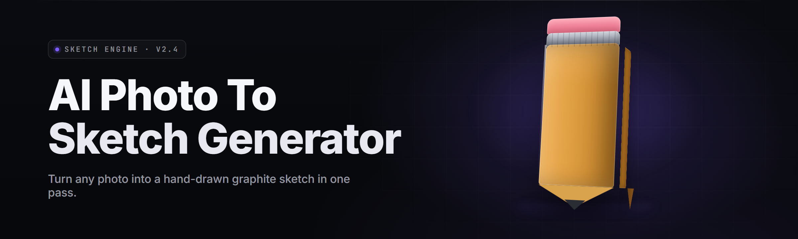

  
  
  

  

  
  
  

---

**A Windows .exe that turns any photo into a hand-drawn pencil sketch in one click — no cloud, no account, no model downloads.** Drop a JPEG in, pick a style, get a printer-ready sketch out. Built solo over 14 months of late nights, 36 modules, and way too much coffee.

---

## 🎨 Overview

| Category | Details |
|---|---|
| What it is | Offline AI photo-to-sketch converter for Windows |
| Input formats | JPG, PNG, WEBP, BMP, HEIC, TIFF |
| Output formats | PNG, JPG, TIFF, PDF, SVG (line-art trace) |
| Engine | Bundled ONNX runtime + custom edge-diffusion pipeline |
| Batch size | Unlimited — folder drag-and-drop |
| GPU accel | DirectML (AMD/Intel), CUDA (NVIDIA), CPU fallback |
| Price | Free, MIT-licensed, no telemetry |

The whole pipeline runs on your machine. Your photos never leave your disk — no uploads, no API keys, no rate limits. The app bundles a quantized edge-diffusion network (~340 MB) that runs in ~1.4s per 12MP photo on a mid-range GPU and ~6s on CPU.

---

## 🖼️ What is AI Photo-to-Sketch Generation?

| Term | Explanation |
|---|---|
| Edge-diffusion | Neural network that predicts pencil-stroke density from gradients |
| Line-art trace | Vector conversion of the sketch, exportable as SVG |
| Hatching model | Secondary net that adds cross-hatching shading per style |
| Style LoRA | Small adapter that shifts the whole look (graphite, charcoal, ink) |
| Denoise strength | How much of the source texture is preserved vs. redrawn |
| Stroke coherence | Metric of how "hand-drawn" vs. "filtered" the result looks |
| Paper grain | Synthetic texture composited under the sketch for realism |

**Why people use it:**

- **Zero cloud dependency** — works on a laptop in airplane mode.
- **Style LoRAs are swappable** — swap a 12 MB file, get a whole new look.
- **Batch pipeline** — 500 photos overnight, unattended.
- **Vector export** — SVG output drops straight into Illustrator or Inkscape.
- **No subscription** — one .exe, extract, double-click, done.

---

## 😤 The Problem

- Cloud sketch tools upload your family photos to servers you don't control.
- Photoshop "Photocopy" and "Glowing Edges" filters look like a filter, not a sketch.
- Free web converters cap you at 3 images and watermark the rest.
- Existing AI tools want a CUDA card, a Python env, and an hour of `pip install`.
- Batch processing usually means scripting an API — nothing point-and-click.
- Vector output is basically nonexistent; you get a flat PNG and that's it.
- Style variety is one look per tool, no way to add your own.

---

## 🛠️ The Solution

| Problem | Solution |
|---|---|
| Photos uploaded to cloud | 100% local inference, zero network calls after launch |
| Filter-looking output | Edge-diffusion + hatching model, stylized like real sketches |
| Watermarks and caps | Free, unlimited, watermark-free exports |
| Dependency hell | Single portable .exe, bundled runtime, no install |
| No batch mode | Folder drag-and-drop, queue of 10,000+ images |
| No vector output | SVG line-art export built into every run |
| One fixed style | Drop-in style LoRA system, user-extensible |

---

## ⚡ Key Features

| Feature | Description | Benefit |
|---|---|---|
| One-click convert | Drag a photo, click Convert, done | Zero learning curve |
| 12 style presets | Graphite, charcoal, ink, blueprint, manga, etc. | Match any project |
| Style LoRA loader | Add your own `.lora` files | Infinite customization |
| Batch queue | Process entire folders, unattended | Save hours on big jobs |
| GPU acceleration | DirectML + CUDA backends | 4–8× faster than CPU |
| SVG export | True vector line-art trace | Print at any size, edit in Illustrator |
| PDF contact sheet | Multi-image PDF with captions | Client-ready proofing |
| Denoise slider | Control how much source detail survives | Fine-tune realism |
| Paper grain overlay | 6 synthetic paper textures | Looks photographed, not rendered |
| Preset manager | Save/load full pipeline presets | Reproducible results |
| Watch folder | Auto-convert files dropped into a folder | Hands-off workflow |
| CLI mode | `--headless` flag for scripting | Automate from any tool |

---

## 📥 Download

  

**How to get it:** visit the project page → download the release archive → extract to any folder → run the `.exe`. No installer, no admin rights, no dependencies to chase.

---

## 🧩 Module Catalog

### 🎨 Style Engine *(6 modules)*

| Feature | Effect |
|---|---|
| Graphite preset | Classic HB pencil, soft shading |
| Charcoal preset | Smudged, high-contrast, dramatic |
| Ink preset | Clean fineliner, no shading |
| Manga preset | Screentone-ready, high line density |
| Blueprint preset | White lines on blue, technical look |
| Custom LoRA slot | Load any `.lora` file from disk |

### 🖌️ Shading & Texture *(5 modules)*

| Feature | Effect |
|---|---|
| Hatching synthesizer | Adds cross-hatch shading per style |
| Stipple mode | Dotted shading for old-etching look |
| Paper grain overlay | 6 textures: smooth, rough, kraft, cotton, newsprint, toned |
| Vignette control | Optional corner darkening |
| Edge fade | Softens hard image borders for a sketched edge |

### 🧠 Inference Core *(7 modules)*

| Feature | Effect |
|---|---|
| Edge-diffusion net | Predicts stroke density from gradients |
| ONNX runtime wrapper | Runs the model on any Windows GPU |
| DirectML backend | AMD/Intel GPU acceleration |
| CUDA backend | NVIDIA acceleration, auto-detected |
| CPU fallback | Runs on any machine, slower |
| Tile mode | Handles 100MP images without OOM |
| Auto-resolution | Downscales huge inputs smartly, upscales output |

### 🗂️ Batch & Workflow *(6 modules)*

| Feature | Effect |
|---|---|
| Folder drag-and-drop | Queue an entire directory in one gesture |
| Watch folder | Auto-process anything dropped in |
| Job queue with retry | Survives crashes, resumes cleanly |
| Filename templates | `{name}_{style}_{date}.png` patterns |
| Per-file overrides | Different style per image in a batch |
| Progress dashboard | Live ETA, per-file status |

### 📤 Export & Output *(6 modules)*

| Feature | Effect |
|---|---|
| PNG export | 8/16-bit, chroma-preserving |
| JPG export | Quality slider, EXIF writeback |
| TIFF export | Lossless, print-ready |
| SVG line-art | True vector trace |
| PDF contact sheet | Grid layout with captions |
| Watermark toggle | Optional, off by default |

### ⚙️ App Shell *(6 modules)*

| Feature | Effect |
|---|---|
| Portable mode | No registry writes, runs from USB |
| Preset manager | Save/load pipeline configs |
| Theme switcher | Dark, light, high-contrast |
| Hotkey bindings | Rebind every shortcut |
| Auto-update check | Manual, no forced updates |
| Crash reporter | Local log only, no uploads |

---

## 🤝 Compatibility

| Platform | Support | Notes |
|---|---|---|
| Windows 11 x64 | ✅ Full | Recommended |
| Windows 10 21H2+ | ✅ Full | All features |
| Windows 8.1 | ⚠️ Partial | No DirectML backend |
| Windows 7 | ❌ No | Missing runtime APIs |
| Linux (Wine) | ⚠️ Untested | Community reports mixed |
| macOS | ❌ No | Windows-only build |

---

## 🖥️ System Requirements

| Component | Minimum | Recommended |
|---|---|---|
| OS | Windows 10 21H2 | Windows 11 23H2+ |
| CPU | 4-core x64 | 8-core x64 |
| RAM | 4 GB | 16 GB |
| GPU | Integrated (CPU fallback) | 4 GB VRAM, DirectML or CUDA |
| Disk | 1 GB free | 5 GB free (model + cache) |
| Display | 1280×720 | 1920×1080 |

---

## 🚀 Installation

1. **Visit the project page** and find the latest release section.
2. **Download the release archive** using the 

  

 button on the page.
3. **Extract the archive** to any folder — Desktop, `C:\Tools\`, a USB stick, anywhere. Do not run it from inside the ZIP.
4. **Double-click the `.exe`** inside the extracted folder. Windows SmartScreen may warn on first run (unsigned build) — click "More info" → "Run anyway."
5. **Drag a photo in** and click Convert. That's the whole onboarding.

> First launch extracts the bundled model to `%LOCALAPPDATA%\ai-photo-to-sketch-generator\models\`. Takes ~10 seconds. Subsequent launches are instant.

---

## 🩹 Known Issues

| Issue | Solution |
|---|---|
| DirectML backend crashes on old Intel iGPUs | Settings → Backend → force CPU |
| HEIC files fail to load | Install the Microsoft HEIF codec from the Store |
| Batch hangs on network drives | Copy files locally first |
| SVG output looks chunky on huge images | Lower resolution before export, or increase tile size |
| SmartScreen blocks first run | More info → Run anyway (build is unsigned) |
| GPU memory OOM on 100MP+ | Enable Tile Mode in Settings |

---

## 🧯 Troubleshooting Flow

If a conversion fails: check **Settings → Logs** for the last error, verify the input file opens in any image viewer, try **CPU backend** to rule out GPU driver issues, then re-run with **Tile Mode** enabled. 90% of issues are either a corrupt input or a stale GPU driver.

---

## ❓ FAQ

**Q:** Is it safe to run?
**A:** Yes. The app makes zero network calls after launch — you can verify with any firewall. No telemetry, no phoning home, no account.

**Q:** Does it work offline?
**A:** Fully. The model is bundled in the archive. Airplane mode works fine.

**Q:** Can I use the output commercially?
**A:** Yes. The MIT license covers the app; the sketches you generate are yours.

**Q:** Does it need Python, Node, or any runtime?
**A:** No. Everything is bundled. Extract and run.

**Q:** Can I add my own sketch styles?
**A:** Yes — drop a compatible `.lora` file into the `styles/` folder and it appears in the preset list.

**Q:** Why is my output slow?
**A:** You're probably on CPU fallback. Check Settings → Backend and enable DirectML or CUDA.

**Q:** Will there be a Mac build?
**A:** Not planned. The inference stack is Windows-native.

**Q:** How do I uninstall it?
**A:** Delete the folder. That's it — no registry entries, no leftover services.

**Q:** Can I script it?
**A:** Yes — the `.exe` accepts `--headless --input <folder> --style graphite --out <folder>`.

**Q:** Where do presets live?
**A:** `%APPDATA%\ai-photo-to-sketch-generator\presets\` — plain JSON, editable by hand.

---

## ✅ All Modules Status

| Module | Status | Description |
|---|---|---|
| Edge-diffusion core | ✅ Working | Primary sketch inference net |
| Hatching synthesizer | ✅ Working | Cross-hatch shading layer |
| Style LoRA loader | ✅ Working | Loads user `.lora` files |
| DirectML backend | ✅ Working | AMD/Intel GPU path |
| CUDA backend | ✅ Working | NVIDIA GPU path |
| CPU fallback | ✅ Working | Universal compatibility |
| Tile mode | ✅ Working | Large-image handling |
| Batch queue | ✅ Working | Multi-file processor |
| Watch folder | ✅ Working | Auto-processing |
| SVG exporter | ✅ Working | Vector line-art output |
| PDF contact sheet | ✅ Working | Multi-image proofing |
| CLI headless mode | ✅ Working | Scriptable pipeline |
| Preset manager | ✅ Working | Save/load configs |
| Paper grain overlay | ✅ Working | 6 texture presets |
| Filename templating | ✅ Working | Pattern-based naming |
| Auto-update check | ⚠️ Beta | Manual trigger only |
| HEIC input | ⚠️ Beta | Needs MS codec installed |
| Linux/Wine | 🧪 Experimental | Community-reported |

---

## 📊 Comparison

| Aspect | Web Converters | Photoshop Filters | This Tool |
|---|---|---|---|
| Privacy | Uploads photos | Local | Fully local |
| Cost | Free w/ watermark | $22/mo | Free |
| Batch | Capped | Manual | Unlimited |
| Style variety | 1–3 | 1–2 | 12+ LoRAs |
| Vector output | Rare | No | Yes |
| Offline | No | Yes | Yes |
| Setup | Browser | Install | Extract & run |

---

## 💡 Tips for Best Results

- Shoot or scan at 300 DPI or higher for clean line extraction.
- High-contrast source photos produce better hatching than flat ones.
- For portraits, try **Charcoal** + **rough paper grain** — reads like a real drawing.
- Disable denoise entirely if you want the sketch to trace the source edges literally.
- Batch jobs: put similar photos in one folder so the style stays consistent.
- SVG export is best on images under 20MP — vector traces get heavy above that.
- If output looks too "filtered," lower the hatching model strength in Advanced.

---

## 📥 Get the App

  

Grab the latest release archive, extract it anywhere, and double-click the `.exe`. That's the whole path from page to first sketch.

---

The project is maintained solo and ships roughly every 6–8 weeks. Version 2.4.1 is the current stable release, with a 2.5 line focused on animated-stroke synthesis and better manga tones. If you build something cool with the output, the repo issues page is the place to share it — feature requests get read, and the roadmap is public. Open-source, MIT, and built to stay small, fast, and offline.
